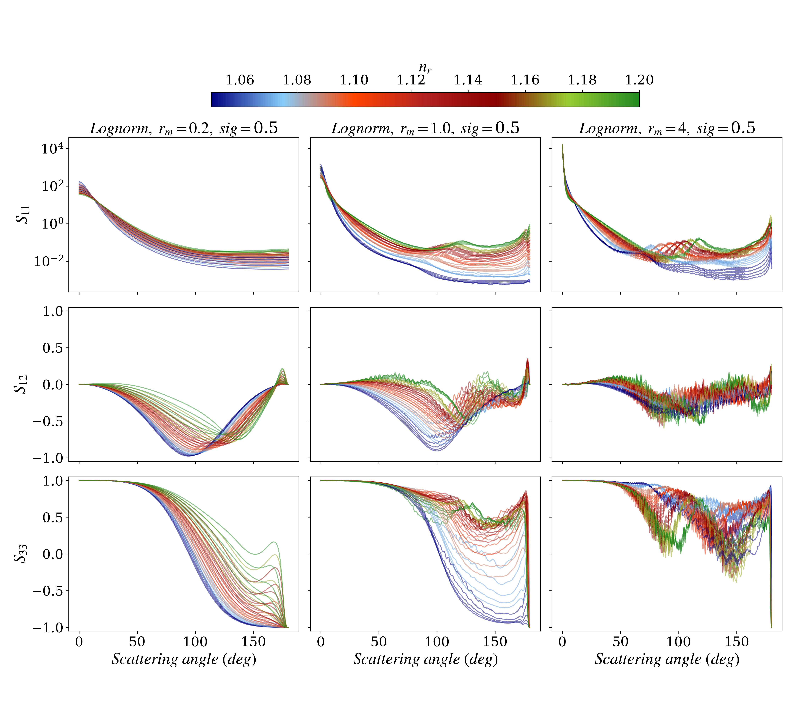

# Mie_perso
## Scientific code for fast mie computation based on PyMieScatt
## Getting Started


### Installation

First, clone [the repository](https://github.com/Tristanovsk/mie_perso), and execute the following command in the
local copy:

```
pip install . 
```

This will install the package into the system's Python path.
If you have not the administrator rights, you can install the package as follows:

```
pip install -e .
```

### Examples

Check notebooks for basic examples. You could be able to reproduce massive computation and get scattering matrix for different size (or refractive index) distrubtions.

 

### Theory in a nutshell

The scattering by a homogeneous sphere (Mie, 1908) only depends on the size parameter
$x = 2\pi r/\lambda$ ($\lambda$ the wavelength in the medium) and on the refractive
index $m = n + ik$ relative to the medium. The far-field amplitude functions are
series of the Mie coefficients $a_n$, $b_n$:

$$
S_1(\theta) = \sum_{n=1}^{n_{max}} \frac{2n+1}{n(n+1)} \left(a_n \pi_n + b_n \tau_n\right),
\qquad
S_2(\theta) = \sum_{n=1}^{n_{max}} \frac{2n+1}{n(n+1)} \left(a_n \tau_n + b_n \pi_n\right),
$$

from which the four independent terms of the scattering matrix are computed,

$$
S_{11} = \tfrac{1}{2}\left(|S_2|^2 + |S_1|^2\right), \quad
S_{12} = \tfrac{1}{2}\left(|S_2|^2 - |S_1|^2\right), \quad
S_{33} = \tfrac{1}{2}\left(S_2^* S_1 + S_2 S_1^*\right), \quad
S_{34} = \tfrac{i}{2}\left(S_1 S_2^* - S_2 S_1^*\right),
$$

and integrated over a particle size distribution $n(r)$ to get the scattering matrix
$F_{ij}$ and mean cross sections of a particle population. See the
*Theoretical background* page of the documentation for the full set of equations
(Bohren and Huffman, 1983; Mishchenko and Travis, 2008; Sumlin et al., 2018).
